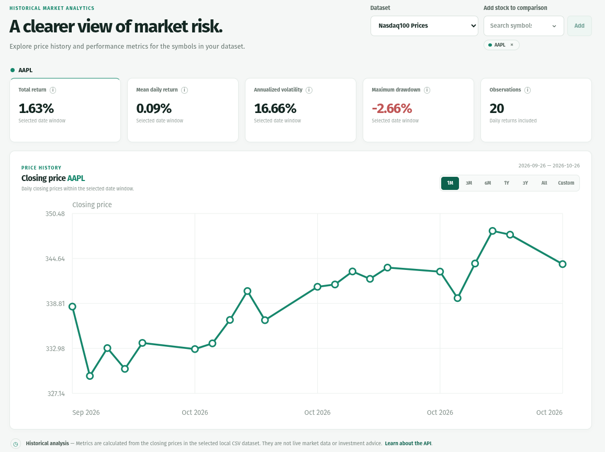

# MarketLens

MarketLens is a small local market analytics app. It validates historical closing prices from a CSV file, calculates price performance and risk metrics, and presents them in a responsive browser dashboard. The included prices are illustrative only: MarketLens has no live market feed and does not provide investment advice.

## What’s included

- **Dashboard:** choose a CSV dataset, add any number of symbols to a comparison, and overlay their historical closing prices over a preset or custom date window.
- **API:** FastAPI endpoints for health, datasets, available symbols, analytics, and historical prices.
- **Data checks:** invalid dates, symbols, prices, duplicate rows, and empty datasets are rejected rather than silently repaired.

## Requirements and installation

Python 3.10 or newer and pip are required. From the project root:

```bash
python -m pip install --upgrade pip
python -m pip install -e ".[dev]"
```

## Start the application

```bash
uvicorn marketlens.main:app --reload
```

Open [http://127.0.0.1:8000](http://127.0.0.1:8000) for the dashboard. The interactive API documentation is at [http://127.0.0.1:8000/docs](http://127.0.0.1:8000/docs).

see more in **Tests** section below.

## API endpoints

- `GET /health` — basic service health.
- `GET /datasets` — lists CSV files in `data/` and identifies the configured default.
- `GET /symbols` — sorted symbols from the configured CSV.
- `GET /analytics/{symbol}` — total return, annualized volatility, maximum drawdown, mean daily return, and return observation count. Optional `start` and `end` dates (ISO `YYYY-MM-DD`, inclusive) limit the analytics window.
- `GET /prices/{symbol}` — chronologically ordered historical closing prices for the chart.

The price response has this shape:

```json
{
  "symbol": "AAPL",
  "prices": [
    {"date": "2026-01-05", "close": 100.0},
    {"date": "2026-01-06", "close": 110.0}
  ]
}
```

Pass a dataset id from `/datasets` to the data endpoints with the `dataset` query parameter, for example `GET /symbols?dataset=nasdaq100_prices.csv` or `GET /analytics/AAPL?dataset=nasdaq100_prices.csv`. The dashboard does this automatically when you change the dataset selector. The symbol field provides searchable suggestions from the selected dataset. Type a ticker and choose **Add**; repeat to overlay as many stocks as you want. Each stock has its own color and five metric cards. The chart keeps dates on the x-axis and closing prices on the y-axis; focus or hover over a point to see that date's price. Remove a stock using the × on its ticker chip. The selected date window applies to both the chart and metric cards. Quick windows include one, three, six, and twelve months, three years, all history, and a custom date range.

An unknown symbol returns 404. Invalid or unavailable server-side data returns a structured 500 response. Analytics returns 422 when there are too few daily returns to calculate sample volatility.

## Data format and configuration

The CSV needs these columns:

```csv
date,symbol,close
2026-01-05,AAPL,100.00
2026-01-06,AAPL,110.00
```

Dates must be parseable, symbols non-empty, and closes finite and greater than zero. A date/symbol pair must be unique. The default file is `data/sample_prices.csv`, resolved from the project location. To select another file, set `MARKETLENS_DATA_PATH` before starting the app. Relative custom paths are resolved from the server's working directory.

## Data and calculations

MarketLens validates and normalizes historical price data before calculating performance and risk metrics. The input CSV must contain `date`, `symbol`, and `close` columns. Invalid data, duplicate records, and empty datasets are rejected.

The API provides daily and total returns, mean daily return, annualized volatility, and maximum drawdown. Metrics are calculated independently for each symbol using its available historical observations.

For more details, see:
- [Rate of Return](https://www.investopedia.com/terms/r/rateofreturn.asp) — understanding price returns.
- [Standard Deviation](https://www.investopedia.com/terms/s/standarddeviation.asp) — measuring return variability.
- [Maximum Drawdown](https://www.investopedia.com/terms/m/maximum-drawdown-mdd.asp) — measuring peak-to-trough declines.

See the source code and tests for the exact formulas, validation rules, and calculation conventions used by MarketLens.

## Metrics

Daily returns are simple price changes between consecutive available observations. Total return compares the first and last prices. Annualized volatility uses sample standard deviation (`ddof=1`) multiplied by `sqrt(252)`. Mean daily return is the arithmetic average of daily returns. Maximum drawdown is the largest decline from a prior running peak. The observation count is the number of daily returns, one fewer than the number of price rows.

These measures use closing prices only: dividends and other corporate actions are not included.

## Tests

Run the backend and API tests with:

```bash
pytest -v
```

### Dataset source

The Nasdaq-100 historical dataset in `data/nasdaq100_prices.csv` contains daily closing prices downloaded from [Yahoo Finance](https://finance.yahoo.com/) using yfinance. The constituent symbols come from [Nasdaq's Nasdaq-100 company breakdown](https://www.nasdaq.com/articles/global-indexes/nasdaq-100-index); the public [Wikipedia constituent list](https://en.wikipedia.org/wiki/List_of_NASDAQ-100_companies) is used as a fallback if Nasdaq's page cannot be fetched. Prices use Yahoo Finance's `Close` field without dividend adjustment (`auto_adjust=False`). The small `data/sample_prices.csv` dataset is illustrative sample data, not downloaded market history.

### Dashboard figures

Single-stock view:



Overlapping stock comparison:


